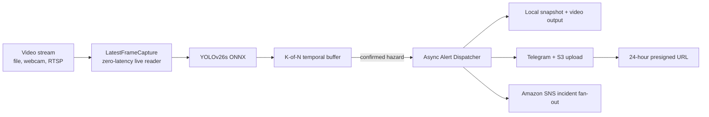
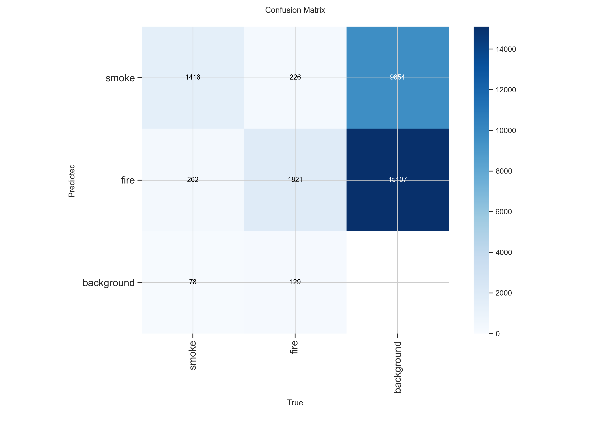
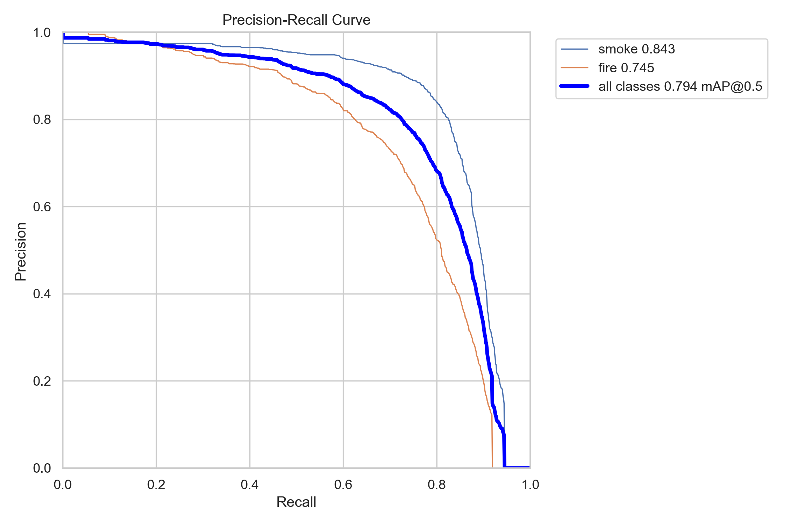
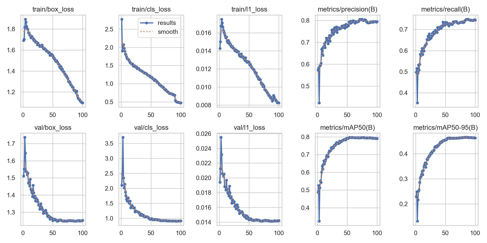

# Edge Smoke & Fire Detection with YOLOv26s

Production-oriented computer vision deployment for detecting **smoke** and **fire**
in CCTV, drone, and edge-camera video. The project began as a university deep
learning benchmark and is now organized as a portable inference service with an
ONNX model, temporal alert filtering, and an asynchronous Telegram and AWS
incident pipeline.

## Why this matters

Frame-by-frame detectors can repeatedly flag a static background artifact. In
this project, the detector produced 1,094 static-background false alarms during
deployment testing. A K-of-N temporal persistence filter requires a hazard to
appear consistently across recent frames before notifying an operator, reducing
noise without changing the model weights.

## Architecture



## Repository layout

| Path | Purpose |
| --- | --- |
| `deploy_detector.py` | Root CLI entry point |
| `src/config.py` | Portable paths, defaults, and `.env` loading |
| `src/detector.py` | YOLO inference and K-of-N temporal buffering |
| `src/notifier.py` | Threaded Telegram, S3, and SNS incident dispatcher |
| `src/gui.py` | Cross-platform Tkinter live HUD |
| `models/` | Deployment ONNX and PyTorch weights |
| `data/sample_videos/` | Small local inputs for demonstrations |
| `data/outputs/` | Generated videos and alert snapshots (ignored by Git) |
| `results/runs_summary/` | Lightweight experiment evidence |
| `assets/` | README-ready evaluation plots |
| `notebooks/` | Research, training, benchmarking, and evaluation notebook |

## Benchmark results

Validation mAP values and latency measurements are from the notebook benchmark:
GPU results were measured on an RTX 5060 Laptop GPU; CPU results used four
threads, batch size one, and 640px input. Total latency includes preprocessing,
inference, and post-processing.

| Model | mAP@50-95 | GPU latency (ms) | GPU FPS | 4-thread CPU latency (ms) | CPU FPS |
| --- | ---: | ---: | ---: | ---: | ---: |
| YOLOv8s | 0.44614 | 4.18 | 239.3 | 72.47 | 13.80 |
| YOLOv11s | 0.45594 | 4.03 | 248.0 | 60.07 | 16.65 |
| YOLOv12s | 0.45620 | 5.10 | 195.9 | 80.78 | 12.38 |
| YOLOv26n | 0.44571 | 2.22 | 449.7 | 22.92 | 43.62 |
| **YOLOv26s** | **0.45987** | **4.35** | **229.7** | **63.43** | **15.77** |
| YOLOv26l | 0.46853 | 19.32 | 51.8 | 298.69 | 3.35 |

YOLOv26l has the highest validation mAP, but YOLOv26s is the deployment
Pareto choice: it is close to the accuracy ceiling while remaining practical
for real-time GPU use and edge CPU fallback. YOLOv26n is faster, but gives up
accuracy for the target operating point.

## Ablation and error analysis

- **Regularization:** YOLOv26s tuning used weight decay, dropout, and label
  smoothing. The best validation mAP@50-95 improved from **0.4599 to 0.4653**
  (+0.0054), while mAP@50 changed from 0.7964 to 0.7944.
- **Temporal filtering:** a 5-frame buffer with 4 required hazard hits prevents
  single-frame background artifacts from becoming alerts.
- **Test split:** the tuned model achieved mAP@50 **0.7933** and mAP@50-95
  **0.4543** on the held-out test evaluation. Smoke was stronger than fire,
  with per-class mAP@50-95 of 0.5248 and 0.3838 respectively.

Selected plots:





## Quickstart

The project uses `uv` for reproducible environment management:

```powershell
uv venv
uv pip install --python .venv\Scripts\python.exe -r requirements.txt
Copy-Item .env.example .env
uv run --python .venv\Scripts\python.exe deploy_detector.py --source data\sample_videos\sample_fire3.mp4 --no-gui --save
```

The shortest interactive command is:

```powershell
uv run --python .venv\Scripts\python.exe deploy_detector.py
```

Interactive mode keeps the model loaded after a video ends or the HUD closes.
It asks whether to select another video, webcam, or stream, so the GPU warm-up
only happens once per process. Passing `--source` remains one-shot and exits
after that source finishes.

Live camera and RTSP/HTTP sources use a threaded latest-frame capture mode that
drains OpenCV's FIFO buffer to avoid CPU/Docker latency. Local MP4, AVI, and MKV
inputs remain in sequential frame-by-frame mode.

Useful options:

```text
--model PATH          Custom ONNX or PyTorch weights
--source SOURCE       Video path, webcam index, or RTSP/HTTP URL
--conf VALUE          Detection confidence (default: 0.10)
--buffer FRAMES       Temporal window size (default: 5)
--hits COUNT          Required detections in the window (default: 4)
--cooldown SECONDS    Minimum alert interval (default: 60)
--save                Write an annotated MP4 to data/outputs/videos/
--enable-alerts       Enable configured Telegram delivery
--no-gui              Disable the Tkinter HUD
```

## Configuration and integrations

Copy `.env.example` to `.env`. Telegram delivery requires
`TELEGRAM_BOT_TOKEN` and `TELEGRAM_CHAT_ID`. AWS delivery uses the standard
`boto3` credential chain plus `AWS_REGION`, `AWS_S3_BUCKET`, and
`AWS_SNS_TOPIC_ARN`. Each confirmed alert is uploaded to S3 under a
date-partitioned `incidents/YYYY-MM-DD/` key, then published to SNS with the
S3 URI and a 24-hour presigned URL. The URL is also appended to the Telegram
caption when both integrations are active. Never commit `.env` or credentials.

## MLOps alert pipeline

The Docker-compatible deployment path uses `LatestFrameCapture` to drain live
camera/RTSP buffers in a daemon thread while preserving sequential file reads.
`AlertDispatcher` then performs local snapshot persistence and asynchronous
fan-out to Telegram, Amazon S3, and Amazon SNS. AWS failures are logged inside
the background worker and do not terminate video inference.

## Future work

Optional VLM verification can be added later as a separate false-alarm
verification stage after the deterministic detector and cloud alert pipeline.

## Research notebook

Open `notebooks/DL_Term_Project_Notebook.ipynb` for dataset exploration,
controlled YOLOv8s/v11s/v12s/v26n/v26s/v26l comparisons, regularization
experiments, GPU and four-thread CPU benchmarks, and held-out test evaluation.
The dataset is not included in this repository.

## Safety

This is a research and portfolio deployment demonstration. Do not use its
predictions as the sole means of fire detection, emergency response, or life
safety.
